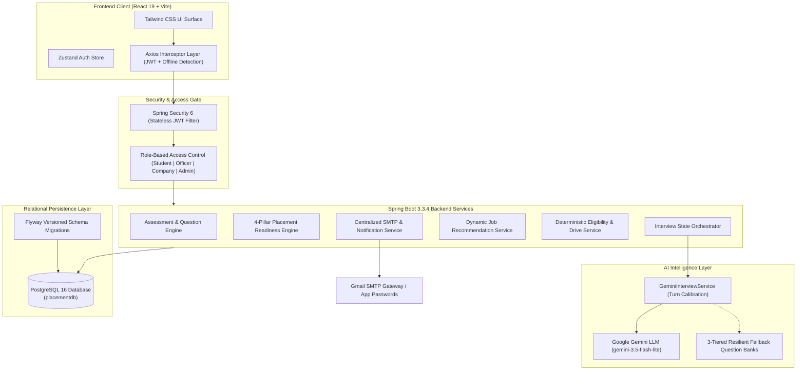

# 🚀 Ascend — AI-Assisted Placement Readiness & Institutional Intelligence System

<div align="center">


**An enterprise-grade campus placement intelligence and recruitment lifecycle platform developed for higher education institutions (Rajiv Gandhi University of Knowledge Technologies).**

[Live Application](#-quick-start) • [Architecture](#-system-architecture) • [Core Features](#-core-architectural-innovations) • [Demo Credentials](#-demonstration-credentials) • [API Reference](#-api-endpoints-reference)

</div>

---

## 📖 Table of Contents

- [Overview](#-overview)
- [System Architecture](#-system-architecture)
- [Core Architectural Innovations](#-core-architectural-innovations)
  - [1. 4-Pillar Dynamic Placement Readiness Scoring](#1-4-pillar-dynamic-placement-readiness-scoring-0100)
  - [2. Adaptive Turn-by-Turn AI Mock Interview Simulator](#2-adaptive-turn-by-turn-ai-mock-interview-simulator)
  - [3. Dynamic Career-Specific Assessments & Review Mode](#3-dynamic-career-specific-assessments--review-mode)
  - [4. Verified Live Placement Opportunities](#4-verified-live-placement-opportunities)
  - [5. Campus Placement Operations & Deterministic Eligibility Gate](#5-campus-placement-operations--deterministic-eligibility-gate)
  - [6. Centralized Institutional Email & OTP Verification](#6-centralized-institutional-email--otp-verification)
- [Role-Based Access Control (RBAC)](#-four-tier-role-based-access-control-rbac)
- [Technology Stack](#-technology-stack)
- [Quick Start & Setup Guide](#-quick-start)
- [Demonstration Credentials](#-demonstration-credentials)
- [API Endpoints Reference](#-api-endpoints-reference)
- [Repository Structure](#-project-structure)
- [License & Capstone Credits](#-license--acknowledgments)

---

## 🌟 Overview

**Ascend** is an institutional placement readiness platform engineered to solve the disconnect between university curricula and competitive engineering recruitment standards. It transforms subjective placement preparation into a calibrated, data-driven diagnostic pipeline.

Rather than relying on generic multiple-choice tests or uncalibrated mock questions, Ascend integrates:
- **Calibrated Mathematical Diagnostics:** Pinpoints exact deficit vectors against tier-1 industry benchmarks.
- **Adaptive AI Technical Interviews:** Dynamically scales question complexity from foundational concepts to high-scale distributed systems trade-offs.
- **End-to-End Recruitment Operations:** Governs the entire on-campus recruitment cycle from requisition intake to final candidate selection.

---

## 🏗️ System Architecture



---

## 🎯 Core Architectural Innovations

### 1. 4-Pillar Dynamic Placement Readiness Scoring (0–100%)

Traditional placement apps suffer from artificial score inflation (e.g., scoring 90% on one test jumps total readiness from 10% to 43%). Ascend solves this with a **4-Pillar Dynamic Readiness Model** calibrated against real hiring benchmarks:

$$\text{Readiness Index} = (\text{Technical} \times 0.45) + (\text{Interviews} \times 0.25) + (\text{Academic} \times 0.15) + (\text{Portfolio} \times 0.15)$$

| Pillar | Weight | Description & Scoring Mechanics |
| :--- | :---: | :--- |
| **Technical Domain Skills** | **45%** | Proportional evaluation across core role competencies (e.g. Java, DBMS, DSA, Frontend). Unattempted competencies remain at 0%, preventing artificial leaps on single-test completion. Blends track-specific mock exams. |
| **AI Mock Technical Rounds** | **25%** | Incorporates turn evaluation depth and practice consistency factor: $\text{avgScore} \times \min(1.0, 0.45 + 0.20 \times \text{rounds})$. Multiple rounds steadily build candidate readiness points. |
| **Academic Standing** | **15%** | Normalized CGPA score on 100-scale with systematic backlog penalties ($\text{Score} = (\text{CGPA} \times 10) - (\text{Backlogs} \times 10)$). |
| **Profile & Portfolio** | **15%** | Evaluates real-world industry signals: verified skills (35 pts), uploaded resume (30 pts), GitHub/portfolio URL (20 pts), and declared career goal (15 pts). |

---

### 2. Adaptive Turn-by-Turn AI Mock Interview Simulator

- **Turn-by-Turn Difficulty Calibration:**
  - **Turn 1 (Easy / Foundational):** Core OOP principles, memory concepts, fundamental definitions. Allows candidate warm-up without complex distributed race conditions.
  - **Turn 2 (Medium / Practical):** Mechanics, internal component interactions, concurrency primitives, practical queries.
  - **Turn 3 (Medium-to-Hard / Resilience):** Edge cases, transaction isolation, failure handling, performance bottlenecks.
  - **Turn 4 (Advanced / Architecture):** Horizontal scaling, distributed caching trade-offs, high-concurrency architecture.
- **Session Persistence Across Logins:** Active sessions are permanently recorded in PostgreSQL (`mock_interview_sessions` and `interview_responses`). Ongoing interviews auto-restore on re-login, preventing loss of progress during network drops or password resets.
- **Resilient Fallback Banks:** If API quotas or network outages occur, multi-tier fallback banks ensure candidates experience continuous, realistic interviews.
- **Candidate Progression Dashboard:** Tracks round count, average technical index, communication clarity, and current difficulty tier.

---

### 3. Dynamic Career-Specific Assessments & Review Mode

- **4 Canonical Industry Tracks:**
  1. `Java Full Stack Developer` (Java, Spring Boot, SQL/DBMS, Web Frontend, OOP, Quantitative Aptitude, DSA)
  2. `MERN Full Stack Developer` (React, Node.js, Express, MongoDB, JavaScript/ES6, System Design)
  3. `AI / ML Engineer` (Python, PyTorch/TensorFlow, Linear Algebra, Machine Learning Models, Data Pipelines)
  4. `Data Analyst` (SQL, Data Analytics, BI Visualization, Statistics, Python/R)
- **Shuffled, Unbiased Question Banks:** Randomized option distribution eliminates positional answer biases.
- **Interactive Test Review Mode:** Immediate post-assessment review displays candidate choices, correct keys, and comprehensive technical explanations.

---

### 4. Verified Live Placement Opportunities

- **Direct Verified Opportunities:** Job recommendations link directly to active corporate career portals and application endpoints (no dead placeholder buttons).
- **Cosine Skill-Vector Matching:** Recommends jobs tailored to candidate verified competencies, target career paths, and readiness metrics.
- **Real-Time Recruiter Requisitions:** Direct integration with live requisitions submitted by campus recruitment partners.

---

### 5. Campus Placement Operations & Deterministic Eligibility Gate

- **TPO Recruitment Console:** Training and Placement Officers configure campus drives with strict eligibility criteria:
  - Minimum CGPA thresholds (e.g., 7.5+)
  - Department / Branch restrictions (CSE, ECE, MECH, etc.)
  - Maximum allowable active backlogs (e.g., 0 backlogs allowed)
- **Deterministic Pre-Validation Gate:** Automatically validates applications before submission. Disqualified candidates receive transparent, unambiguous explanations.
- **4-Stage Application Pipeline:** `APPLIED` $\rightarrow$ `ASSESSMENT` $\rightarrow$ `SHORTLISTED` $\rightarrow$ `SELECTED`.

---

### 6. Centralized Institutional Email & OTP Verification

- **Centralized Spring Mail Gateway:** Dispatches institutional verification OTPs, password reset links, application status updates, and daily TPO digests via Google SMTP.
- **Delivery Auditing & Retries:** Logs all outbound emails into `notification_logs` with delivery status, error traces, and administrative retry endpoints (`/api/admin/notification-logs/{id}/retry`).

---

## 👥 Four-Tier Role-Based Access Control (RBAC)

| Portal | Base Route | Authorized Actors | Key Capabilities |
| :--- | :--- | :--- | :--- |
| **Student** | `/student/*` | Registered Students | Take diagnostic tests, review answers, simulate AI interviews, inspect 4-pillar readiness, explore verified jobs, apply for drives. |
| **Placement Officer (TPO)** | `/officer/*` | Institutional Placement Team | Create & publish drives, enforce eligibility rules, track student pipelines, review external recruiter opportunities, export hiring reports. |
| **Corporate Recruiter** | `/company/*` | Verified Corporate Partners | Submit job requisitions, view authorized candidate profiles, filter applicant pipelines, log candidate interview feedback. |
| **System Admin** | `/admin/*` | Institutional Administrators | Manage user accounts, curate 13 question banks across all career domains, review public recruiter submissions, audit notification delivery logs. |
| **Public Recruiter Intake** | `/api/public/opportunities` | Unauthenticated External Partners | Submit campus hiring opportunities without an account; generates a secure tracking reference ID for follow-up. |

---

## 💻 Technology Stack

| Layer | Technologies |
| :--- | :--- |
| **Frontend Framework** | **React 19**, React Router DOM v7, Vite 8 |
| **Styling & Icons** | **Tailwind CSS v3.4**, Lucide React, JetBrains Mono font |
| **State Management & Network** | **Zustand 5**, Axios (with JWT interceptor & offline detection) |
| **Backend Framework** | **Spring Boot 3.3.4**, Java 21 LTS |
| **Security & Auth** | Spring Security 6, Stateless JWT (jjwt 0.11.5), BCrypt Password Hashing |
| **Database & Migrations** | **PostgreSQL 16**, Spring Data JPA, Hibernate ORM, **Flyway 10** |
| **AI & NLP Services** | **Google Gemini API** (`gemini-3.5-flash-lite`), Dynamic Prompt Engineering |
| **Email & Scheduling** | Spring Mail (JavaMailSender), Spring Task Scheduling (`@Scheduled`) |
| **Containerization** | Docker, Docker Compose |

---

## 🚀 Quick Start

### Prerequisites
- **Java 21 LTS** (Amazon Corretto, Eclipse Temurin, or Oracle JDK)
- **Node.js 18+** & npm
- **Docker** & Docker Compose (or a local PostgreSQL 16 instance)

---

### 1. Database Setup (Docker)

Start the PostgreSQL database container with one command:

```bash
docker compose up -d
```

*Verifies container `ascend-postgres` is running on port `5432` with database `placementdb`.*

---

### 2. Backend Configuration & Startup

Configure your environment variables (optional; sensible defaults exist for local development):

```properties
# backend/src/main/resources/application.properties
spring.datasource.url=jdbc:postgresql://localhost:5432/placementdb?options=-c%20timezone=Asia/Kolkata
spring.datasource.username=postgres
spring.datasource.password=password

# Optional: Google Gemini API Key for dynamic interviews
gemini.api.key=YOUR_GEMINI_API_KEY
```

Build and run the Spring Boot backend:

```bash
cd backend
./mvnw clean package -DskipTests
java "-Duser.timezone=Asia/Kolkata" -jar target/placement-readiness-system-1.0.0.jar
```

*The backend starts on `http://localhost:5000` and automatically runs Flyway migrations and database seeders.*

---

### 3. Frontend Startup

In a separate terminal window:

```bash
cd frontend
npm install
npm run dev
```

*The Vite dev server starts on `http://localhost:5173`.*

---

### 4. One-Click Dual Launch (Windows)

On Windows, launch both backend and frontend concurrently:

```cmd
start.bat
```

---

## 🔐 Demonstration Credentials

The application seeds default accounts for rapid evaluation across all institutional roles:

| Role | Email | Password | Identifier / Batch Details |
| :--- | :--- | :--- | :--- |
| **Student (E4 Final Year)** | `s210018@rguktsklm.ac.in` | `sathwik@18` | RGUKT Srikakulam • CSE B.Tech E4 (Final Year) |
| **Student (E3 Pre-Final)** | `s220145@rguktsklm.ac.in` | `Student@123` | RGUKT Srikakulam • CSE B.Tech E3 (Pre-Final) |
| **Placement Officer (TPO)** | `officer@college.edu` | `Officer@123` | Training & Placement Office Console |
| **Corporate Recruiter** | `hr@techcorp.com` | `Company@123` | TechCorp Talent Acquisition |
| **System Administrator** | `admin@system.com` | `Admin@123` | Master Question Bank & System Auditing |

---

## 📡 API Endpoints Reference

### Authentication & Recovery (`/api/auth`)
- `POST /api/auth/login`: Authenticate user and issue JWT token.
- `POST /api/auth/register-student`: Student account registration with RGUKT roll number validation.
- `POST /api/auth/send-otp`: Dispatches verification OTP via SMTP.
- `POST /api/auth/verify-otp`: Validates 6-digit OTP code.
- `POST /api/auth/reset-password`: Reset password using verified OTP token.

### Student Placement & Analysis (`/api/analysis`, `/api/assessments`, `/api/interviews`)
- `GET /api/analysis/report`: Retrieve current 4-pillar placement readiness report.
- `POST /api/analysis/generate`: Recalculate dynamic readiness index and skill gap remediations.
- `GET /api/assessments/categories`: Retrieve all 13 test categories and mock assessments.
- `POST /api/assessments/submit`: Submit completed test attempt and calculate score.
- `GET /api/interviews/sessions/active`: Retrieve ongoing active mock interview session.
- `POST /api/interviews/sessions/start`: Initialize a new progressive turn-based AI interview.
- `POST /api/interviews/sessions/{id}/answer`: Submit turn answer and receive evaluated feedback.
- `POST /api/interviews/sessions/{id}/discard`: Discard an in-progress interview session.

### Campus Placement Operations (`/api/placement`, `/api/officer`, `/api/company`)
- `GET /api/placement/drives`: List all campus drives with eligibility flags for current student.
- `POST /api/placement/apply`: Submit student application to a campus drive.
- `POST /api/officer/drives`: TPO creates a new campus recruitment drive.
- `GET /api/officer/applications`: TPO views student application pipeline.
- `PUT /api/officer/applications/{id}/status`: Advance applicant stage (`APPLIED` $\rightarrow$ `SELECTED`).
- `POST /api/public/opportunities`: Public recruiter intake endpoint (unauthenticated).
- `GET /api/admin/notification-logs`: Administrative audit log of all system email dispatches.

---

## 📁 Project Structure

```
placement-readiness-system/
├── backend/
│   ├── src/main/java/com/placement/system/
│   │   ├── config/              # SecurityConfig, DatabaseSeeder, QuestionBankSeeder
│   │   ├── controller/          # RESTful Controllers (15 core endpoints)
│   │   ├── dto/                 # Request & Response DTOs
│   │   ├── model/               # JPA Entities (Student, User, Drive, Interview, Test)
│   │   ├── repository/          # Spring Data Repositories
│   │   ├── scheduler/           # TPO Daily Digest Cron Scheduler
│   │   ├── service/             # GeminiInterviewService, Analysis, Placement, Email
│   │   └── util/                # CareerStandard benchmarks & RguktUtils
│   ├── src/main/resources/
│   │   ├── db/migration/        # Flyway V1__initial_schema.sql
│   │   └── application.properties
│   └── pom.xml
├── frontend/
│   ├── src/
│   │   ├── api/                 # Axios HTTP client with offline and auth handlers
│   │   ├── components/          # ReadinessGauge, modal dialogs, drawers
│   │   ├── layouts/             # AppLayout (Sidebar, Breadcrumbs, Role Switcher)
│   │   ├── pages/
│   │   │   ├── admin/           # AdminDashboard, Question Banks, User Auditing
│   │   │   ├── auth/            # RoleLoginView, SignInForm, ForgotPasswordForm
│   │   │   ├── company/         # CompanyDashboard, Requisition Modal
│   │   │   ├── officer/         # OfficerDashboard, CreateDrive, Applications
│   │   │   └── student/         # Tests, TakeTest, Analysis, MockInterview, Jobs
│   │   ├── store/               # authStore (Zustand)
│   │   └── utils/               # careerStandards.js
│   ├── package.json
│   └── vite.config.js
├── docker-compose.yml           # PostgreSQL 16 container definition
├── start.bat                    # Dual-stack Windows launch script
├── DESIGN.md                    # Institutional design tokens & guidelines
├── PRODUCT.md                   # Product requirements & user personas
└── README.md                    # Primary documentation
```

---

## 📜 License & Acknowledgments

This software was engineered as an academic capstone project for **Rajiv Gandhi University of Knowledge Technologies (RGUKT)**, Department of Computer Science & Engineering.

*Empowering engineering graduates with transparent, explainable placement intelligence.*
